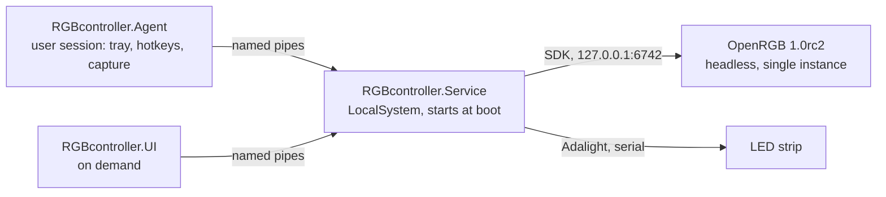

# RGBcontroller

Windows controller for PC RGB lighting and an Adalight ambilight strip, built to replace OpenRGB's Effects plugin (about 2.6% CPU) with a background service that targets under 1%.

  

> **Status: stage 0 (foundation).** Configuration, logging, IPC contracts and the OpenRGB SDK client exist and are unit tested. The Service does not drive any hardware yet. See [Roadmap](#roadmap).

```text
> RGBcontroller.Service.exe --console --data-dir %TEMP%\rgbc-stage0
[INF] RGBcontroller.Service.Program: RGBcontroller.Service 0.0.1.0 starting in console mode, data folder ...\rgbc-stage0
[INF] RGBcontroller.Service.Program: Config CreatedDefault from ...\rgbc-stage0\config\config.json
[INF] RGBcontroller.Service.Program: Strip: 113 LEDs, 115200 baud, max 30 FPS, port auto (VID 1A86 PID 7523)
[INF] RGBcontroller.Service.Program: Running; press Ctrl+C to stop
```

## Key features (implemented)

- **Own OpenRGB SDK client for OpenRGB 1.0rc2**: it speaks SDK protocol 5, including the device rescan request (packet 140). OpenRGB.NET 3.1.1 stops at protocol 4 and has no rescan; see the [spike report](docs/spikes/R2-R3-openrgb-sdk.md).
- **Allocation-free LED writes**: `UpdateLeds` reuses one send buffer, and a unit test asserts zero allocated bytes over 100 writes after warm-up.
- **Fails loudly, never hangs**: requests time out against a hung OpenRGB, dropped connections raise `Disconnected`, and malformed controller data is rejected by an exact-length parser.
- **Versioned configuration**: schema-versioned JSON with a migration chain, atomic writes, quarantine of corrupt files, and validation. For example, the OpenRGB host must be a loopback address.
- **Versioned IPC**: a JSON-RPC control contract (StreamJsonRpc) with a major/minor handshake that reports mismatched versions instead of crashing, plus a fixed 16-byte binary header for LED frame streams.
- **CPU measurement that works on Polish Windows**: [`tools/Measure-RGBcontroller.ps1`](tools/Measure-RGBcontroller.ps1) reads process times through `NtQuerySystemInformation` (`typeperf` fails on localized systems).

## Tech stack

| Area | Technology |
|---|---|
| Runtime | C# on .NET 10 (`net10.0`, `net10.0-windows`) |
| Hardware access | OpenRGB 1.0rc2 SDK server (TCP, loopback), Adalight over a serial port (planned stage 1) |
| IPC | Named pipes with StreamJsonRpc 2.26 (System.Text.Json formatter) |
| Logging | Serilog 4.4 with rolling files |
| Tests | xUnit v3 on Microsoft.Testing.Platform |
| Planned | WPF + WebView2 shell with a React/TypeScript front end, DXGI Desktop Duplication via Vortice.Windows |

## Architecture



Only the Service touches hardware. It runs without a logged-in user, so lighting can start on the logon screen. The Agent and UI talk to it over versioned named-pipe IPC. The full specification is in [SPEC.md](SPEC.md).

## Getting started

Requirements: Windows 10 or 11 and the .NET 10 SDK. `build.ps1` also finds a user-local SDK installed with the official script:

```powershell
& ([scriptblock]::Create((Invoke-WebRequest https://dot.net/v1/dotnet-install.ps1 -UseBasicParsing).Content)) -Channel 10.0
```

Build and run the tests:

```powershell
.\build.ps1 -Test
```

Run the Service skeleton in the console. It writes a default config and logs to the given folder and does not touch any hardware:

```powershell
.\src\RGBcontroller.Service\bin\Debug\net10.0-windows\RGBcontroller.Service.exe --console --data-dir "$env:TEMP\rgbc-stage0"
```

## Project structure

```text
src/
  RGBcontroller.Core/      config, logging, OpenRGB SDK client (effects and device model later)
  RGBcontroller.Ipc/       JSON-RPC contracts and frame codec shared by all processes
  RGBcontroller.Service/   background service (console skeleton in stage 0)
  RGBcontroller.Agent/     user-session tray agent (skeleton)
  RGBcontroller.UI/        on-demand UI shell (skeleton)
tests/RGBcontroller.Tests/ unit tests, including a fake OpenRGB SDK server
tools/                     CPU measurement script
docs/spikes/               technical spike reports
reference/                 verified hardware evidence (test scripts, measurements)
```

## Testing

```powershell
.\build.ps1 -Test
```

The suite has 61 tests. They cover config load, migration and recovery, validation, logging, IPC round-trips over an in-memory duplex stream, the frame codec, and the OpenRGB client against an in-process fake SDK server.

## Roadmap

Each stage ends with a hardware test gate on the target PC.

1. **Service + OpenRGB supervisor + Adalight**: lighting on the logon screen after cold boot, single OpenRGB instance.
2. **Effect engine**: Static, Breathing, Wave, Radial, Mirror, Color cycle, Aurora, synchronized across devices, under 1% CPU.
3. **Power and session handling**: sleep, hibernate, display off, lock and shutdown without flicker or duplicate processes.
4. **Agent and ambilight**: screen capture with letterbox and HDR handling, tray, global hotkeys.
5. **UI**: tiles with live previews, device mapping and strip layout wizards, profiles.
6. **Installer and hardening**.

## License

All rights reserved. No license is granted to use, copy or modify this code.

## Author

Radek Wójcik
