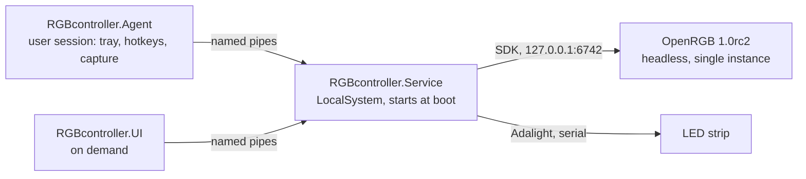

# RGBcontroller

Windows controller for PC RGB lighting and an Adalight ambilight strip, built to replace OpenRGB's Effects plugin (about 2.6% CPU) with a background service that targets under 1%.

  

> **Status: stage 1 of 6 done.** A Windows Service lights the Adalight strip and all OpenRGB devices in one static color, already on the logon screen. Effects, power handling, ambilight and the UI come next; see [Roadmap](#roadmap).

Service log after a restart on the target PC (Windows started at 13:08:46):

```text
13:08:58.199 [INF] LightingHost: Lighting host starting at 13:08:58.095, system uptime 00:00:12
13:08:59.249 [INF] LightingHost: First light Adalight strip on COM3 1153 ms after Service start
13:09:03.256 [INF] OpenRgbSupervisor: Connected to OpenRGB SDK (protocol 5, server 5) 5160 ms after Service start
13:09:03.260 [INF] DeviceLighting: First light Razer Ornata Chroma V2 (132 LEDs) 5164 ms after Service start; Keyboard=132
13:09:03.260 [INF] DeviceLighting: Applied #00E5FF to 5 OpenRGB devices
```

## Key features (implemented)

- **Lit before you log in**: a LocalSystem service with automatic start lights the strip 13 s and every OpenRGB device 17 s after boot, before the logon screen appears (measured with [`tools/Measure-TimeToFirstLight.ps1`](tools/Measure-TimeToFirstLight.ps1)).
- **Exactly one OpenRGB, without the Effects plugin**:
  - The Service runs a pinned OpenRGB 1.0rc2 copy that has no plugins folder.
  - It runs headless, bound to `127.0.0.1`, with its own config folder, inside a kill-on-close job object.
  - Strays are removed; crashes and hung SDKs are restarted with back-off.
  - Device rescans happen inside the same instance.
- **Static lighting at 0.000% CPU**: the Service and OpenRGB together averaged 0.000% of the CPU with a static color, compared with 2.58% for OpenRGB with the Effects plugin (same tool, same PC).
- **Reliable Adalight strip driver**:
  - Finds the port by USB VID/PID and waits for the board to settle after opening it.
  - Writes only on change, with a 1 s keep-alive.
  - Clamps to the serial link's frame rate and applies an estimated current limiter.
  - Reconnects after the USB device disappears, and always ends with black.
- **Own OpenRGB SDK client for protocol 5**:
  - Pushes Direct mode to the hardware with `UPDATEMODE`, sets ARGB zone sizes from the config and requests rescans (packet 140).
  - Writes LEDs without allocating, and times out instead of hanging.
  - See the [spike reports](docs/spikes/).
- **Versioned configuration and IPC**:
  - Configuration is schema-versioned JSON with migrations, atomic writes and validation (for example, the OpenRGB host must be loopback).
  - IPC is a JSON-RPC contract with a version handshake.

## Tech stack

| Area | Technology |
|---|---|
| Runtime | C# on .NET 10 (`net10.0`, `net10.0-windows`), self-contained ReadyToRun service build |
| Hardware access | OpenRGB 1.0rc2 SDK server (TCP, loopback), Adalight over `System.IO.Ports` |
| Service | `System.ServiceProcess.ServiceBase`, Win32 job object |
| IPC | Named pipes with StreamJsonRpc 2.26 (System.Text.Json formatter) |
| Logging | Serilog 4.4 with rolling files in `%ProgramData%\RGBcontroller\logs` |
| Tests | xUnit v3 on Microsoft.Testing.Platform, fake OpenRGB SDK server, fake serial port |
| Planned | WPF + WebView2 shell with a React/TypeScript front end, DXGI Desktop Duplication via Vortice.Windows |

## Architecture



Only the Service touches hardware. It runs without a logged-in user, so lighting starts on the logon screen. The Agent and UI (later stages) talk to it over versioned named-pipe IPC. The full specification is in [SPEC.md](SPEC.md).

## Getting started

Requirements:
- Windows 10 or 11.
- The .NET 10 SDK.
- The PawnIO driver, for SMBus devices such as RAM.
- OpenRGB 1.0rc2 (commit `0fca93e`) installed in `C:\Program Files\OpenRGB`. This is the source of the pinned copy, which is verified by SHA-256.

`build.ps1` also finds a user-local SDK installed with the official script:

```powershell
& ([scriptblock]::Create((Invoke-WebRequest https://dot.net/v1/dotnet-install.ps1 -UseBasicParsing).Content)) -Channel 10.0
```

Copy the pinned OpenRGB (plugins excluded), then build and run the tests:

```powershell
.\tools\Get-PinnedOpenRgb.ps1
.\build.ps1 -Test
```

Install the Service for development. Run it from an elevated PowerShell. It disables (never deletes) an existing `OpenRGB_Admin` autostart task:

```powershell
.\install-dev.ps1
```

Undo everything and restore the previous OpenRGB autostart:

```powershell
.\uninstall-dev.ps1
```

## Usage

The static color and the hardware settings live in `%ProgramData%\RGBcontroller\config\config.json`. Only administrators can write this file. Restart the service after editing it.

| Setting | Default | Meaning |
|---|---|---|
| `lighting.staticColor` | `#00E5FF` | Color for all devices and the strip |
| `lighting.stripBrightnessPercent` | `50` | Strip brightness, 100 = full diode power |
| `lighting.deviceBrightnessPercent` | `100` | Brightness of the OpenRGB devices |
| `strip.portName` | `null` | COM port override; `null` = find by VID/PID `1A86:7523` |
| `strip.ledCount` | `113` | LEDs on the strip |
| `openRgb.zoneSizes` | 3 x 20 | LED counts of the motherboard ARGB headers |

Diagnostics:

```powershell
& 'C:\Program Files\RGBcontroller\RGBcontroller.Service.exe' --probe --rescan
.\tools\Measure-TimeToFirstLight.ps1
.\tools\Measure-RGBcontroller.ps1 -Label static -DurationSeconds 60
```

`--probe` only reads from the running OpenRGB; with `--rescan` it also asks OpenRGB to re-detect the devices and times it.

## Project structure

```text
src/
  RGBcontroller.Core/      config, logging, Adalight frames and strip writer, OpenRGB SDK client
  RGBcontroller.Ipc/       JSON-RPC contracts and frame codec shared by all processes
  RGBcontroller.Service/   Windows Service: OpenRGB supervisor, device lighting, probe
  RGBcontroller.Agent/     user-session tray agent (skeleton, stage 4)
  RGBcontroller.UI/        on-demand UI shell (skeleton, stage 5)
tests/RGBcontroller.Tests/ unit tests with a fake OpenRGB SDK server and a fake serial port
tools/                     pinned OpenRGB copy, CPU and time-to-first-light measurement
third_party/               pin manifest of OpenRGB 1.0rc2 (the binaries themselves are not committed)
docs/spikes/               technical spike reports with hardware results
reference/                 verified hardware evidence (test scripts, measurements)
install-dev.ps1            reversible development install
```

## Testing

```powershell
.\build.ps1 -Test
```

The suite has 95 tests. They cover the following:
- config load, migration, recovery and validation, plus logging;
- IPC round-trips and the frame codec;
- Adalight frames: header, color order, brightness, current limiter, no allocations;
- the strip writer against a fake serial port: reconnect, keep-alive, black on stop;
- the OpenRGB supervisor against an in-process fake SDK server: Direct mode, zone resize, re-apply after device list changes, restart after a crash or a hung SDK, black on stop.

## Roadmap

Each stage ends with a hardware test gate on the target PC.

1. ~~**Service + OpenRGB supervisor + Adalight**: lighting on the logon screen after cold boot, single OpenRGB instance.~~ Done (`v0.1.0-stage1`).
2. **Effect engine**: Static, Breathing, Wave, Radial, Mirror, Color cycle, Aurora, synchronized across devices, under 1% CPU.
3. **Power and session handling**: sleep, hibernate, display off, lock and shutdown without flicker or duplicate processes.
4. **Agent and ambilight**: screen capture with letterbox and HDR handling, tray, global hotkeys.
5. **UI**: tiles with live previews, device mapping and strip layout wizards, profiles.
6. **Installer and hardening**.

## License

All rights reserved. No license is granted to use, copy or modify this code.

## Author

Radek Wójcik
