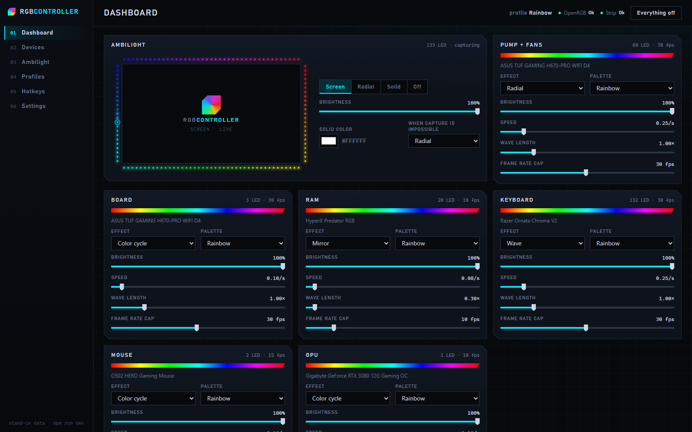
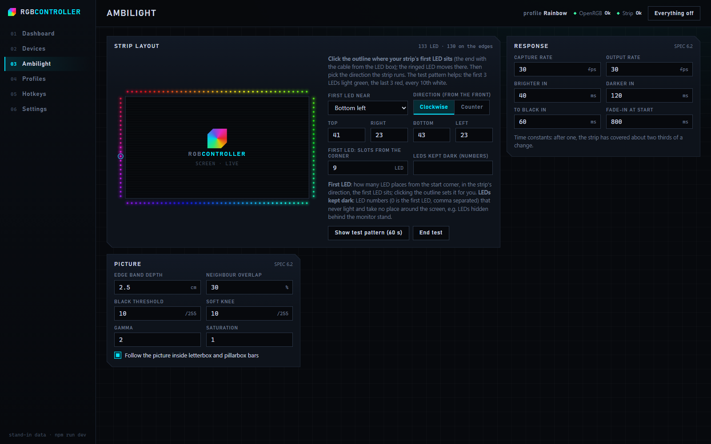
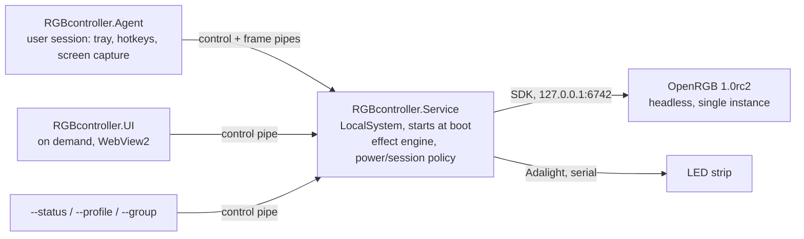
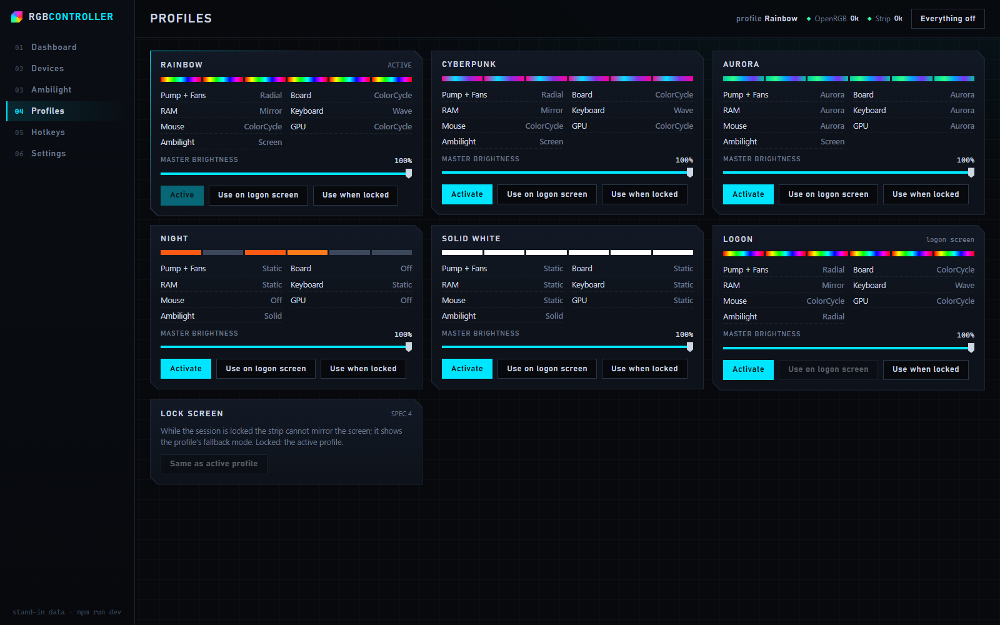

# RGBcontroller

Windows controller for PC RGB lighting and an Adalight ambilight strip: synchronized effects on every OpenRGB device, a screen-mirroring strip behind the monitor, and a background service that replaces OpenRGB's Effects plugin (about 2.6% CPU).

   



> **Status: stage 5 of 6.** The Service, the tray Agent with screen ambilight and hotkeys, and the UI run on the author's PC. The installer (stage 6) is not built yet: installation is a developer install from source, and the default device mapping is the author's hardware (see [Hardware configuration](#hardware-configuration)).

## Key features

- **Effects at a fraction of the old CPU cost**:
  - The full Rainbow profile uses 0.97% of the whole CPU with the RAM at 5 FPS and about 1.7% with the RAM at 10 FPS; OpenRGB with the Effects plugin used 2.58% on the same PC, and a static profile uses 0.012%.
  - The RAM's SMBus writes are almost the whole budget, so every device group has its own frame rate cap.
  - Measured with [`tools/Measure-RGBcontroller.ps1`](tools/Measure-RGBcontroller.ps1); details in [docs/spikes/stage2-effects.md](docs/spikes/stage2-effects.md).
- **Screen ambilight on an Adalight strip**:
  - DXGI Desktop Duplication with the downscale on the GPU, so a 4K frame never reaches the CPU; SDR and HDR (scRGB tone-mapped to the SDR white level).
  - A black screen turns the strip fully off, dark scenes stay dark, fades to black leave no glow.
  - Letterbox and pillarbox bars are detected, also with subtitles, logos or player controls drawn on them, so the strip shows the picture instead of the bars.
  - Modes Screen, Radial (themed palette), Solid and Off; a 4K desktop that does not change costs the Agent next to nothing.
- **One clock for every device**: effects Static, Breathing, Wave, Radial, Mirror, Color cycle, Aurora and Off, laid out by LED position (matrix, line, ring), so waves and rings line up across the keyboard, RAM, fans and strip; writes happen only when colors change.
- **Lighting that follows the PC's state**: a Logon profile on the logon screen, the active profile when unlocked, a Lock profile when locked; display off turns off configurable sets of devices; black before sleep and shutdown; after resume or when USB devices reappear, the single OpenRGB rescans and every device gets its effect back.
- **Lit before you log in, with exactly one OpenRGB**: a LocalSystem service lights the strip about 13 s and every OpenRGB device about 17 s after boot, supervising a pinned OpenRGB 1.0rc2 without plugins, bound to `127.0.0.1`, in a kill-on-close job object.
- **Tray, hotkeys and a UI that is not resident**: global hotkeys through `RegisterHotKey` (no keyboard hook) with an on-screen note of what changed, a dark tray menu, and a WebView2 window that is started on demand and leaves nothing running when closed.



## Tech stack

| Area | Technology |
|---|---|
| Runtime | C# on .NET 10 (`net10.0`, `net10.0-windows`), self-contained ReadyToRun builds |
| Hardware access | OpenRGB 1.0rc2 SDK server (own client, protocol 5, loopback), Adalight over `System.IO.Ports` |
| Screen capture | DXGI Desktop Duplication through Vortice.Windows 3.8 (D3D11, GPU mip downscale) |
| Service | `ServiceBase` with power and session events, `PowerSettingRegisterNotification` for the display state, `CM_Register_Notification` for USB arrivals, Win32 job object |
| Agent | WinForms tray icon and menu, `RegisterHotKey` |
| UI | WPF + WebView2 shell; React 19, TypeScript 7, Vite 8 front end |
| IPC | Named pipes with StreamJsonRpc 2.26 (System.Text.Json formatter), versioned protocol (1.5) |
| Logging | Serilog 4.4, rolling files |
| Tests | xUnit v3 on Microsoft.Testing.Platform (fake OpenRGB SDK server, fake serial port), Vitest |

## Architecture



Only the Service touches hardware. It runs without a logged-in user, so lighting starts on the logon screen. The Agent captures the screen and sends strip colors to the Service; the UI edits the configuration through the Service, which validates and saves it. The full specification is in [SPEC.md](SPEC.md).

## Getting started

Requirements:
- Windows 10 or 11 (developed on Windows 10 22H2).
- The .NET 10 SDK. `build.ps1` also finds a user-local SDK in `%LOCALAPPDATA%\Microsoft\dotnet`.
- Node.js 24 LTS for the UI front end, on `PATH` or unpacked in `%USERPROFILE%\.tools\nodejs`. Without it the UI shows a basic test page.
- OpenRGB 1.0rc2 (commit `0fca93e`) installed in `C:\Program Files\OpenRGB`; the build copies it without plugins after checking its SHA-256 against [`third_party/openrgb-pin.json`](third_party/openrgb-pin.json).
- The PawnIO driver, for SMBus devices such as RAM (installed with OpenRGB).
- The Microsoft Edge WebView2 Runtime (part of current Windows 10 and 11).

Install the .NET 10 SDK for the current user if needed:

```powershell
& ([scriptblock]::Create((Invoke-WebRequest https://dot.net/v1/dotnet-install.ps1 -UseBasicParsing).Content)) -Channel 10.0
```

Copy the pinned OpenRGB, then build everything and run the tests:

```powershell
.\tools\Get-PinnedOpenRgb.ps1
.\build.ps1 -Test
```

Install from an elevated PowerShell. The script publishes the Service, the Agent and the UI to `C:\Program Files\RGBcontroller`, registers and starts the Service, starts the Agent at logon, creates Desktop and Start menu shortcuts, and disables (never deletes) an existing `OpenRGB_Admin` autostart task. Close OpenRGB and AmbiBox first; it is safe to run again to update:

```powershell
.\install-dev.ps1
```

Undo everything and restore the previous OpenRGB autostart (`-RemoveData` also deletes the configuration and logs):

```powershell
.\uninstall-dev.ps1
```

## Usage

### Tray icon and hotkeys

The Agent shows the RGBcontroller mark in the notification area. A left or right click opens the menu: Open RGBcontroller, Profiles, Ambilight mode, strip brightness slider, Turn everything off/on, Exit Agent. The icon turns grey when everything is off and gets an amber dot when OpenRGB or the strip has a problem.

| Hotkey | Action |
|---|---|
| Ctrl+F9 | Solid color on, or back to the previous strip mode |
| Ctrl+F10 | Next strip mode: Screen, Radial, Solid, Off |
| Ctrl+F11 / Ctrl+F12 | Strip brightness down / up (10% steps); up also turns an Off strip back on |

Every hotkey shows a short note at the bottom of the screen with the new strip state. Hotkeys are editable on the Hotkeys page (one modifier plus one key).

### The UI

Open it from the tray, the Desktop shortcut or the Start menu. Closing the window ends the process.

| Page | What it does |
|---|---|
| Dashboard | Live strip preview, strip mode, brightness and solid color; one tile per device group with effect, palette, speed, wave length, brightness and frame rate cap |
| Devices | OpenRGB devices, zones, LED counts and the group that drives each zone |
| Ambilight | Strip layout, test pattern, response (attack, release, fade-in) and picture settings (edge depth, black threshold, gamma, saturation, letterbox detection) |
| Profiles | Activate a profile, master brightness, choose the logon-screen and lock profiles |
| Hotkeys | Record combinations and assign actions |
| Settings | Devices turned off when the display goes off (unlocked and locked), strip port, LED count and current limit, diagnostics, accent color |



### Setting up the strip

1. Settings: set the LED count of your strip (applies after a Service restart).
2. Ambilight: click **Show test pattern**. The first 3 LEDs light green, the last 3 red and every 10th white.
3. Set the number of LEDs on each edge and the direction the strip runs, viewed from the front.
4. Click the outline where the first LED (the cable end) sits; the ringed LED moves there.
5. LEDs hidden behind the monitor stand go into **LEDs kept dark** (LED numbers, 0 = first LED).

### Command line

Control the running Service from a normal PowerShell:

```powershell
$exe = 'C:\Program Files\RGBcontroller\RGBcontroller.Service.exe'
& $exe --status
& $exe --profile "Solid White"
& $exe --group RAM --fps 10 --speed 0.08 --scale 0.3
& $exe --strip-test 60
```

`--group <name> [--in <profile>] [--fps 1-60] [--speed <cycles/s>] [--scale <x>] [--brightness 0-100]` tunes a group live. In PowerShell, write decimals with a dot (`0,08` becomes an array).

## Hardware configuration

The defaults are the author's PC: an ASUS TUF GAMING H670-PRO WIFI D4 with three ARGB headers (pump and fans), HyperX Predator RGB DDR4, a Gigabyte RTX 3080, a Razer Ornata Chroma V2, a Logitech G502 HERO and a 133-LED WS2812B strip on a CH340-based Adalight box. Device groups match OpenRGB device names exactly, so on other hardware edit `lighting.groups` in the configuration (Devices shows the names OpenRGB reports).

The configuration lives in `%ProgramData%\RGBcontroller\config\config.json`. The UI changes it through the Service; editing the file by hand needs administrator rights and a Service restart.

| Setting | Default | Meaning |
|---|---|---|
| `lighting.groups[]` | author's devices | Device groups: OpenRGB device and zone names, frame rate cap |
| `lighting.activeProfile` / `logonProfile` / `lockProfile` | `Rainbow` / `Logon` / `null` | Profile when unlocked, on the logon screen, when locked (`null` = active) |
| `lighting.displayOff.unlocked` / `.locked` | strip / strip, keyboard, mouse | Turned off while the display is off |
| `strip.portName` | `null` | COM port override; `null` finds the CH340 by USB ID `1A86:7523` |
| `strip.ledCount` | `113` | LEDs on the strip |
| `strip.layout` | 40 / 21 / 30 / 21 | Start corner, direction, LEDs per edge, first LED position, dark LEDs |
| `strip.currentLimitMilliamps` | `4500` | Estimated current limit (6.5 mA per fully lit channel) |
| `capture.*` | 30 FPS, gamma 1.5 | Screen pipeline: rates, edge depth, black threshold, attack and release, letterbox detection |
| `hotkeys.bindings` | Ctrl+F9 to Ctrl+F12 | Global hotkeys |
| `openRgb.zoneSizes` | 3 x 20 | LED counts of the motherboard ARGB headers |

## Troubleshooting

| Symptom | Cause and fix |
|---|---|
| The strip shows black during Netflix or other protected video | Windows and the GPU hide DRM-protected video from screen capture; no capture program can read it. Playing in a browser with hardware acceleration turned off makes the picture capturable, at a lower resolution. |
| The strip is frozen on one color and ignores hotkeys | The Adalight box stopped taking data; the log says so if it still answers. Unplug the box's power supply for a few seconds. |
| The strip stays lit while the PC sleeps or is off | The box keeps its last frame on its own supply. RGBcontroller sends black before sleep and shutdown; if the box hangs on a USB hub that loses power (for example a monitor's hub), plug it into a USB port of the PC. |
| Keyboard or mouse show factory colors after the monitor or a hub was off | Fixed automatically: USB arrivals trigger a rescan after 3 s. Check the Service log if it does not happen. |
| An exclusive-fullscreen game shows the fallback mode | Exclusive fullscreen cannot be duplicated; use borderless windowed mode. |
| A hotkey does nothing | Another program owns the combination; the tray icon reports it. Pick another one on the Hotkeys page. |

Logs: Service `%ProgramData%\RGBcontroller\logs`, Agent and UI `%LOCALAPPDATA%\RGBcontroller\logs`. Diagnostics:

```powershell
& 'C:\Program Files\RGBcontroller\RGBcontroller.Service.exe' --probe --rescan
.\tools\Measure-RGBcontroller.ps1 -Label check -DurationSeconds 60
```

## Project structure

```text
src/
  RGBcontroller.Core/      config, effects, lighting engine, ambilight pipeline, Adalight writer, OpenRGB SDK client
  RGBcontroller.Ipc/       JSON-RPC contracts and frame codec shared by all processes
  RGBcontroller.Service/   Windows Service: OpenRGB supervisor, render loop, power/session/display/USB tracking, pipes
  RGBcontroller.Agent/     tray icon, hotkeys, DXGI screen capture
  RGBcontroller.UI/        WPF + WebView2 shell and the bridge to the Service
ui/                        React + TypeScript front end (Vite)
tests/RGBcontroller.Tests/ unit tests with a fake OpenRGB SDK server and a fake serial port
tools/                     pinned OpenRGB copy, front end build, icon, CPU and time-to-first-light measurement
docs/                      handoff, spike reports with hardware results, screenshots
reference/                 verified hardware evidence (test scripts, measurements)
```

## Testing

```powershell
.\build.ps1 -Test
```

223 .NET tests and 9 front end tests: configuration, IPC, the Adalight writer against a fake serial port, effects and the lighting engine, the ambilight pipeline and letterbox detection, the session policy, the OpenRGB supervisor against an in-process fake SDK server, the UI bridge and the strip layout in the front end.

## Roadmap

Each stage ends with a hardware test gate on the target PC.

1. ~~**Service + OpenRGB supervisor + Adalight**~~ Done (`v0.1.0-stage1`).
2. ~~**Effect engine**~~ Done (`v0.2.0-stage2`).
3. ~~**Power and session handling**~~ Done (`v0.3.0-stage3`).
4. **Agent and ambilight**: built; hardware gate in progress.
5. **UI**: built; the device mapping wizard, palette editor and live previews of every device are next.
6. **Installer and hardening**.

## License

All rights reserved. No license is granted to use, copy or modify this code.

## Author

Radek Wójcik
