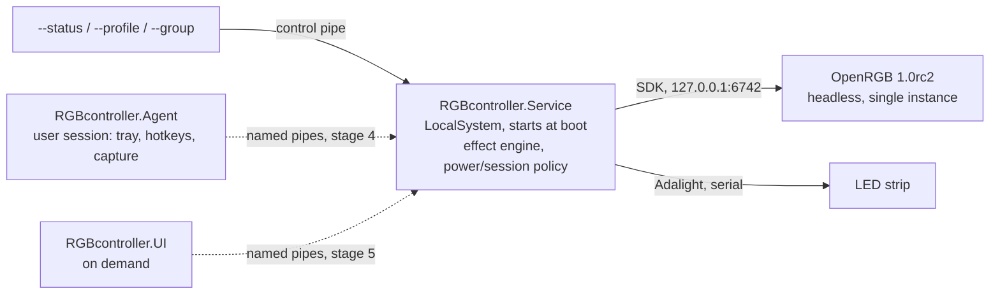

# RGBcontroller

Windows controller for PC RGB lighting and an Adalight ambilight strip, built to replace OpenRGB's Effects plugin (about 2.6% CPU) with a background service that targets under 1%.

  

> **Status: stage 3 of 6 done.** A Windows Service runs synchronized effects on the Adalight strip and all OpenRGB devices from the logon screen on. It follows sleep, lock and display off. Screen ambilight, the tray agent, the UI and the installer come next; see [Roadmap](#roadmap).

Service log on the target PC: the user locks the PC, Windows turns the display off, a mouse move wakes it, the user unlocks (device lists shortened):

```text
17:52:29.315 [INF] SituationTracker: Situation Unlocked, display on -> Locked, display on (after SessionLock)
17:53:46.297 [INF] SituationTracker: Situation Locked, display on -> Locked, display off (after display Off)
17:53:46.298 [INF] LightingEngine: Rendering profile Rainbow (Locked, display off): strip Off (static); ...;
                   Razer Ornata Chroma V2 turned off (static); G502 HERO Gaming Mouse turned off (static)
17:53:49.617 [INF] SituationTracker: Situation Locked, display off -> Locked, display on (after display On)
17:54:02.228 [INF] SituationTracker: Situation Locked, display on -> Unlocked, display on (after SessionUnlock)
```

## Key features (implemented)

- **Effects at a fraction of the old CPU cost**:
  - The full Rainbow profile uses 0.97% of the whole CPU with the RAM at 5 FPS and about 1.7% with the RAM at 10 FPS.
  - OpenRGB with the Effects plugin used 2.58% on the same PC; a static profile uses 0.012%.
  - The RAM's SMBus writes are almost the whole budget, so every device group has its own frame rate cap.
  - Measured with [`tools/Measure-RGBcontroller.ps1`](tools/Measure-RGBcontroller.ps1); details in [docs/spikes/stage2-effects.md](docs/spikes/stage2-effects.md).
- **One clock for every device**:
  - Effects: Static, Breathing, Wave, Radial, Mirror, Color cycle, Aurora, Off, and the device's own hardware modes.
  - LEDs get positions from zone shapes (matrix, line, ring), so waves and rings line up across the keyboard, RAM, fans and strip.
  - Writes happen only when colors change, and a static profile lets the render thread sleep.
- **Lighting that follows the PC's state** (SPEC section 4):
  - Logon profile on the logon screen, active profile when unlocked, Lock profile when locked.
  - Display off turns off the strip; display off while locked also turns off the keyboard and mouse. Both sets are configurable.
  - Black before sleep; after resume the single OpenRGB rescans and all devices return together within about 7 s.
- **Lit before you log in, with exactly one OpenRGB**:
  - A LocalSystem service lights the strip 13 s and every OpenRGB device about 17 s after boot.
  - It supervises a pinned OpenRGB 1.0rc2 without plugins, bound to `127.0.0.1`, inside a kill-on-close job object.
  - Stray instances are removed, and crashes or a hung SDK lead to a restart with back-off.
- **Robust against lost writes**:
  - USB and SMBus writes can be lost without an error, so static frames are sent three times.
  - Device modes are pushed again 5 s and 30 s after every start, resume and rescan.
  - The Adalight writer reconnects after the USB device disappears and always ends with black.
- **Live control without elevation**: `--status`, `--profile` and `--group` talk to the Service over a versioned JSON-RPC named pipe. Changes are applied at once and saved.

## Tech stack

| Area | Technology |
|---|---|
| Runtime | C# on .NET 10 (`net10.0`, `net10.0-windows`), self-contained ReadyToRun service build |
| Hardware access | OpenRGB 1.0rc2 SDK server (own client, protocol 5, loopback), Adalight over `System.IO.Ports` |
| Service | `System.ServiceProcess.ServiceBase` with power and session events, `PowerSettingRegisterNotification` for the display state, WTS session queries, Win32 job object |
| IPC | Named pipes with StreamJsonRpc 2.26 (System.Text.Json formatter) |
| Logging | Serilog 4.4 with rolling files in `%ProgramData%\RGBcontroller\logs` |
| Tests | xUnit v3 on Microsoft.Testing.Platform, fake OpenRGB SDK server, fake serial port |
| Planned | WPF + WebView2 shell with a React/TypeScript front end, DXGI Desktop Duplication via Vortice.Windows |

## Architecture



Only the Service touches hardware. It runs without a logged-in user, so lighting starts on the logon screen. The Agent and UI (later stages) will talk to it over the same versioned named-pipe IPC. The full specification is in [SPEC.md](SPEC.md).

## Getting started

Requirements:
- Windows 10 or 11.
- The .NET 10 SDK.
- The PawnIO driver, for SMBus devices such as RAM.
- OpenRGB 1.0rc2 (commit `0fca93e`) installed in `C:\Program Files\OpenRGB`. This is the source of the pinned copy, which is verified by SHA-256.

`build.ps1` also finds a user-local SDK installed with the official script:

```powershell
& ([scriptblock]::Create((Invoke-WebRequest https://dot.net/v1/dotnet-install.ps1 -UseBasicParsing).Content)) -Channel 10.0
```

Copy the pinned OpenRGB (plugins excluded), then build and run the tests:

```powershell
.\tools\Get-PinnedOpenRgb.ps1
.\build.ps1 -Test
```

Install the Service for development. Run it from an elevated PowerShell. It disables (never deletes) an existing `OpenRGB_Admin` autostart task:

```powershell
.\install-dev.ps1
```

Undo everything and restore the previous OpenRGB autostart:

```powershell
.\uninstall-dev.ps1
```

## Usage

Control the running Service from a normal (non-elevated) PowerShell:

```powershell
$exe = 'C:\Program Files\RGBcontroller\RGBcontroller.Service.exe'
& $exe --status
& $exe --profile "Solid White"
& $exe --group RAM --fps 10 --speed 0.08 --scale 0.3
```

`--group <name> [--in <profile>] [--fps 1-60] [--speed <cycles/s>] [--scale <x>] [--brightness 0-100]` tunes a group live: the frame rate applies to the group in every profile, the other values to its effect in the given profile (default: the active one). In PowerShell, write decimals with a dot (`0,08` becomes an array).

Shipped profiles:

| Profile | Look |
|---|---|
| Rainbow | Radial pump and fans, keyboard wave right to left, RAM mirror, color cycle on the mouse, GPU and board, radial strip |
| Cyberpunk | The Rainbow layout with a pink, cyan and violet palette |
| Aurora | Slow Aurora effect on every device |
| Night | Dim warm static colors; board, mouse and GPU off |
| Solid White | Static white everywhere |
| Logon | A slower Rainbow, shown on the logon screen |

The configuration lives in `%ProgramData%\RGBcontroller\config\config.json`. Only administrators can write the file; restart the Service after editing it.

| Setting | Default | Meaning |
|---|---|---|
| `lighting.activeProfile` | `Rainbow` | Profile while a user is logged in and unlocked |
| `lighting.logonProfile` | `Logon` | Profile on the logon screen |
| `lighting.lockProfile` | `null` | Profile while locked; `null` = the active profile |
| `lighting.displayOff.unlocked` | strip | Turned off when the display goes off while unlocked |
| `lighting.displayOff.locked` | strip, keyboard, mouse | Turned off when the display goes off while locked or on the logon screen |
| `lighting.groups[].maxFps` | 30 (RAM 5, mouse 15, GPU 10) | Frame rate cap per device group |
| `openRgb.resumeRescanDelayMilliseconds` | `3000` | Wait after resume before the rescan |
| `strip.portName` | `null` | COM port override; `null` = find by VID/PID `1A86:7523` |
| `strip.ledCount` | `113` | LEDs on the strip |
| `openRgb.zoneSizes` | 3 x 20 | LED counts of the motherboard ARGB headers |

Diagnostics:

```powershell
& 'C:\Program Files\RGBcontroller\RGBcontroller.Service.exe' --probe --rescan
.\tools\Measure-TimeToFirstLight.ps1
.\tools\Measure-RGBcontroller.ps1 -Label rainbow -DurationSeconds 60
```

`--probe` only reads from the running OpenRGB; with `--rescan` it also asks OpenRGB to re-detect the devices and times it. The Service log in `%ProgramData%\RGBcontroller\logs` records every session, display and power event and the profile rendered for it.

## Project structure

```text
src/
  RGBcontroller.Core/      config, effects, lighting engine and session policy, Adalight writer, OpenRGB SDK client
  RGBcontroller.Ipc/       JSON-RPC contracts and frame codec shared by all processes
  RGBcontroller.Service/   Windows Service: OpenRGB supervisor, render loop, power/session/display tracking, control pipe
  RGBcontroller.Agent/     user-session tray agent (skeleton, stage 4)
  RGBcontroller.UI/        on-demand UI shell (skeleton, stage 5)
tests/RGBcontroller.Tests/ unit tests with a fake OpenRGB SDK server and a fake serial port
tools/                     pinned OpenRGB copy, CPU and time-to-first-light measurement
third_party/               pin manifest of OpenRGB 1.0rc2 (the binaries themselves are not committed)
docs/spikes/               technical spike reports with hardware results, one per stage
reference/                 verified hardware evidence (test scripts, measurements)
install-dev.ps1            reversible development install
```

## Testing

```powershell
.\build.ps1 -Test
```

The suite has 165 tests. They cover the following:
- config load, migration, recovery and validation, plus logging;
- IPC round-trips, the control pipe and the frame codec;
- Adalight frames and the strip writer against a fake serial port: reconnect, keep-alive, black on stop;
- effects, LED layouts and the lighting engine: frame rate caps, change-only writes, brightness, hardware modes, no allocations while rendering, static frame repeats;
- the session policy: logon, lock and active profiles and the display-off turn-off sets;
- the OpenRGB supervisor against an in-process fake SDK server: Direct mode, zone resize, re-apply after device list changes, resume rescan that waits for all devices, restart after a crash or a hung SDK, black on stop.

## Roadmap

Each stage ends with a hardware test gate on the target PC.

1. ~~**Service + OpenRGB supervisor + Adalight**: lighting on the logon screen after cold boot, single OpenRGB instance.~~ Done (`v0.1.0-stage1`).
2. ~~**Effect engine**: synchronized effects, profiles, per-group frame rates, live control.~~ Done (`v0.2.0-stage2`).
3. ~~**Power and session handling**: sleep, lock, display off, logon screen and shutdown.~~ Done (`v0.3.0-stage3`).
4. **Agent and ambilight**: screen capture with letterbox and HDR handling, tray, global hotkeys.
5. **UI**: tiles with live previews, device mapping and strip layout wizards, profiles.
6. **Installer and hardening**.

## License

All rights reserved. No license is granted to use, copy or modify this code.

## Author

Radek Wójcik
